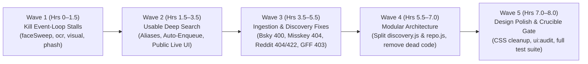

# PRISM v4.19 — Full-Stack Code Review & 8-Hour Engineering Horizon Plan

**Baseline:** `e59bdf8` (v4.18.0) · **Target:** v4.19.0  
**Scope:** Performance & SQLite Event-Loop Unblocking, Usable End-to-End Deep Search, Feed Ingestion & Discovery Hardening, Modular Codebase Architecture, and UI/CSS Polish.

---

## Part 1: Full-Stack Code Review Findings (Evidence-Backed)

### Axis 1 — Performance & Event-Loop Stalls (CRITICAL)
Live production diagnostics (`/api/health`, `/api/admin/logs?level=problems`, and V8 CPU profiles `block-2026-11-12T02-01-13-035Z-42648ms.cpuprofile` and `block-2026-11-12T02-03-04-743Z-34343ms.cpuprofile`) show the Node.js event loop freezing for **23s to 118s every minute**.

| Severity | Component | Location | Root Cause (Proven by CPU Profile / Logs) | Fix |
| :--- | :--- | :--- | :--- | :--- |
| **CRITICAL** | `faceSweep` | `src/engine/maintenance.js:469-473` | **90.7% of 34s–83s main-thread freezes.** Migration `v28` (`src/db/schema.js:965`) built `ix_media_face_todo ON media(seq DESC) WHERE face_at IS NULL AND publish_state = 'published'`, but `faceSweep` orders by `posted_at DESC, seq DESC`. SQLite cannot use `ix_media_face_todo` for ordering, scanning ~389k published rows and sorting a massive temp B-tree on the serving thread every 60s. | Query `FROM media INDEXED BY ix_media_face_todo WHERE face_at IS NULL AND publish_state = 'published' ... ORDER BY seq DESC LIMIT ?` (<5 ms vs 40,000 ms). |
| **CRITICAL** | `ocr.pick` | `src/engine/ocr.js:21-26` | **23.4s event-loop freeze** (`Loop blocked 23455 ms during ocr`). Queries `WHERE ocr_at IS NULL AND publish_state = 'published' ... ORDER BY ingested_at DESC, seq DESC LIMIT ?` with no partial index on `ocr_at IS NULL`. | Add migration `v37` creating `ix_media_ocr_todo ON media(seq DESC) WHERE ocr_at IS NULL AND publish_state = 'published'` and order by `seq DESC`. |
| **HIGH** | `visual.pending` | `src/engine/visual.js:226-235` | **2.5s–3.5s main-thread stalls.** Uses `FROM media m NOT INDEXED` walking backward from `MAX(rowid)`. As recent rows get embedded, it scans hundreds of thousands of already-embedded rows on the main thread every 60s. | Track a high-water/low-water cursor or partial index / indexed `seq DESC` walk so already-embedded ranges are skipped in O(log N). |
| **HIGH** | `PRAGMA optimize` | `src/db/index.js:51` | **5.5s idle freeze** (`Loop blocked 5532 ms during idle`). Runs `db.exec('PRAGMA optimize;')` synchronously on the main serving thread every 6 hours, duplicating `src/engine/backup-worker.js:56` which already runs `PRAGMA optimize` off-thread. | Remove the redundant main-thread `setInterval` in `src/db/index.js:51`. |
| **MEDIUM** | `PhashIndex` | `src/lib/phash-index.js:57-78` | **#2 hotspot in CPU profile** (`121 samples @ phash-index.js:61`). Re-parses 16-char hex into an 8-element array on every `add`, `remove`, and `find`, and stores string UUIDs in hot `0x00`/`0xff` byte buckets across 389k rows. | Pre-compute a `Uint8Array(8)` of chunks per entry, store compact integer IDs in buckets, and yield more frequently in `hashSweep`. |

---

### Axis 2 — Deep Search & Lookup Usability (HIGH)
Deep search (`src/engine/deepsearch.js`, `src/engine/lookup.js`, `public/js/components/deep-pull.js`, `public/js/views/creator.js`, `public/js/views/find.js`) currently feels broken to users for five concrete reasons:

1. **Hidden Behind Admin Key (`public/js/views/creator.js:207`):** The `deepPullControl` component on creator profiles only renders when `adminSession.key` is present in localStorage, and `POST /api/creators/:id/pull` is only mounted under `/api/admin/`. Regular visitors have no way to trigger or see a deep search on a creator profile.
2. **Discovered Feeds Are Never Enqueued (`src/engine/deepsearch.js:246`):** When `takeResult()` adds a newly found social feed via `targets.addSpec()`, it **never calls `engine.enqueue([r.feed.id], { force: true, trigger: 'deep-search' })`**. The user waits 30 seconds for deep search to finish, sees "2 accounts added", and sees **zero new posts** until the background scheduler eventually visits those feeds.
3. **Blind Query Construction (`src/engine/deepsearch.js:162-173`):** `buildQueries(creator)` only searches `creator.display_name` and `creator.handle`. It ignores `creator_aliases` (alt handles found in bios/collabs) and claimed `onlyfans_leads` handles—often the most distinctive usernames a creator uses across the web.
4. **Rigid `samePerson()` Handle Matching (`src/engine/deepsearch.js:105-115`):**
   - Only compares against `creator.handle`, `creator.slug`, and `creator.display_name`—ignoring `creator_aliases` and claimed `onlyfans_leads`.
   - Requires `>= 5` chars for containment and rejects common 1-character suffixes/variants (`mrmusclebearx` vs `mrmusclebear`, `fitjake_` vs `fitjake2`) and digit/word swaps (`10inchdaddy` vs `teninchdaddy`).
5. **Opaque UX in `#/find` and `#/creators/:slug`:**
   - `#/find` shows a static spinner for 15–35s without live phase updates or clear grouping of corroborated accounts.
   - When `/api/lookup` kicks off `deepsearch.start()` in the background (`src/engine/lookup.js:464`), navigating to the creator profile shows no live progress bar, no phase status (`Searching profiles → Checking videos → Matching images → Pulling new posts`), and does not auto-refresh the media grid when new items arrive.

---

### Axis 3 — Feed Ingestion & Discovery Reliability (HIGH)
Live production problem logs (`/api/admin/logs?level=problems`) reveal five recurring discovery/ingestion bugs plus library hygiene backlogs:

1. **Bluesky `getProfiles` & `getSuggestedFollowsByActor` HTTP 400 (`src/engine/discovery.js:843-945`):**
   - Bare handles without a domain (e.g., `Trick`, `ANONANIMEME`, `vadimromanovxxx`) are passed directly as `actor` / `actors[]` parameters to `public.api.bsky.app/xrpc/app.bsky.actor.getProfiles`. AT Protocol rejects any actor string that is neither a `did:` nor a valid domain handle (`*.bsky.social` or `a.b`), failing the **entire 25-actor batch** with `HTTP 400`.
2. **Misskey People Search HTTP 404 (`src/engine/discovery.js:972-975`):**
   - Calls `POST https://${instance}/api/users/search-by-username`, which returns `HTTP 404` on Misskey v2024+ (`misskey.io`). Should use `/api/users/search` (`{ query, limit, offset }`) with a fallback to `/api/users/search-by-username`.
3. **Reddit Community Search HTTP 404 (`src/engine/discovery.js:762-765`):**
   - Calls `https://old.reddit.com/subreddits/search.json`, which returns `HTTP 404` / `403` from datacenter IPs without falling back to Arctic Shift (`https://arctic-shift.photon-reddit.com/api/subreddits/search?subreddit_prefix=...`).
4. **Reddit Archive Discovery HTTP 422 (`src/engine/discovery.js:789-807`):**
   - Calls Arctic Shift `/api/posts/search` directly without the rate-limit backoff and parameter normalization added to `src/sources/reddit.js` in commit `34d78f2`, causing bursts of `WARN HTTP 422`.
5. **GayForFans Directory Crawl HTTP 403 (`src/engine/discovery.js:689-695`):**
   - Crawls `https://gayforfans.com/performer?page=N` directly (which returns `HTTP 403` on Cloudflare-gated pages) without falling back to the sister mirror `https://justthegays.tv/performer?page=N` (unlike `src/sources/gff.js`).

---

### Axis 4 — Codebase Organization & Architecture (MEDIUM)
1. **`src/engine/discovery.js` (2,000 lines):** Monolithic file combining 6 distinct domain responsibilities: directory/archive scouts, Bluesky/Fediverse social-graph walkers, link-hub scrapers, OnlyFans/JustForFans lead tracers, candidate scoring/auto-follow, and avatar face-gate helpers.
2. **`src/db/repo.js` (1,160 lines):** Half-migrated facade (`creators.js`, `media.js`, `takedowns.js` are in `src/db/repos/`, while `feeds`, `runs`, `candidates`, `onlyfans`, and `reports` are still inline in `repo.js`).
3. **Dead Code (`src/sources/_policy.js`):** Unreferenced policy prototype (explicitly noted in `ARCHITECTURE.md`) that duplicates `src/engine/relevance.js`.

---

### Axis 5 — Frontend Design, UX & CSS Architecture (MEDIUM)
1. **Creator Profile & Deep Search Experience (`public/js/views/creator.js`, `public/js/components/deep-pull.js`):**
   - Needs a unified, non-admin-gated **"Find More Across the Web"** status bar that automatically activates when a creator is being deep-searched (or when clicked by a user), displays live step-by-step progress (`Searching profiles`, `Scanning video indexes`, `Matching visual/face similarity`, `Pulling new posts`), and live-streams newly ingested posts into the creator's grid without a page reload.
2. **Find Page (`public/js/views/find.js`):**
   - Needs live multi-stage progress feedback during the 15–35s cross-platform lookup, clearer "Why this matched" provenance pills (e.g., `Shared Linktree`, `Exact handle`, `Alias match`), and a seamless handoff to the creator page showing the active background deep search.
3. **CSS Consolidation (`public/css/app.css`, `v6.css`, `aurora.css`):**
   - 2,505 lines across 3 stylesheets with duplicated component selectors; needs clean token usage and mobile viewport verification (`360px`, `390px`, `430px`, `1280px`).

---

## Part 2: 8-Hour Multi-Wave Implementation Plan

### Wave 1 (Hours 0.0–1.5): Kill the 34s–118s Production Event-Loop Stalls
- **Owner:** `Forge` (verified by `Crucible`)
- **Tasks:**
  1. **Task 1.1 — Fix `faceSweep` B-tree stall (`src/engine/maintenance.js:469-473`):**
     - Update query to use `FROM media INDEXED BY ix_media_face_todo` and `ORDER BY seq DESC LIMIT ?`.
     - Add regression test verifying `EXPLAIN QUERY PLAN` uses `ix_media_face_todo` without `USE TEMP B-TREE FOR ORDER BY`.
  2. **Task 1.2 — Fix `ocr.pick` 23s stall & main-thread `PRAGMA optimize` (`src/db/schema.js`, `src/engine/ocr.js`, `src/db/index.js`):**
     - Add schema migration `v37`: `CREATE INDEX IF NOT EXISTS ix_media_ocr_todo ON media(seq DESC) WHERE ocr_at IS NULL AND publish_state = 'published'`.
     - Update `src/engine/ocr.js:21-26` to use `INDEXED BY ix_media_ocr_todo` and `ORDER BY seq DESC LIMIT ?`.
     - Remove the main-thread `setInterval(() => db.exec('PRAGMA optimize;'))` in `src/db/index.js:51`.
     - Add regression test checking `EXPLAIN QUERY PLAN` for `ocr.pick`.
  3. **Task 1.3 — Fix `visual.pending` scan & `PhashIndex` chunk allocations (`src/engine/visual.js`, `src/lib/phash-index.js`):**
     - Replace `FROM media m NOT INDEXED` full backward scan in `visual.pending` with a bounded/cursor-based `seq` scan so already-embedded ranges aren't re-scanned every 60s.
     - Pre-cache 8-byte `Uint8Array` chunks per entry in `PhashIndex` (`src/lib/phash-index.js`) so `find()` does zero hex parsing or array allocations.

### Wave 2 (Hours 1.5–3.5): Make Deep Search Actually Usable End-to-End
- **Owners:** `Blueprint` (spec), `Forge` (backend engine & routes), `Velocity` + `Pixel` (frontend live UX)
- **Tasks:**
  1. **Task 2.1 — Alias-Aware Queries & Smarter `samePerson` (`src/engine/deepsearch.js`):**
     - Load `creator_aliases` and claimed `onlyfans_leads` handles for the creator at the start of `run()` and in `samePerson()`.
     - Include top distinctive alias/lead handles in `buildQueries(creator)` so creators whose display name is generic (e.g. "Jake") are searched by their real handles across X, Reddit, Bluesky, TikTok, Instagram, and video tubes.
     - Enhance `samePerson(creator, handle, opts)` to match against `creator_aliases` and claimed `onlyfans_leads`, normalize common suffixes (`x`, `xxx`, `vip`, `official`, `free`), and allow edit-distance 1 on handles >= 7 chars.
  2. **Task 2.2 — Immediate Feed Enqueue & Live Post Tracking (`src/engine/deepsearch.js`, `src/routes/public.js`):**
     - When `takeResult()` creates or attaches a feed (`r.feed`), immediately enqueue it via `engine.enqueue([r.feed.id], { force: true, trigger: 'deep-search' })` and record `enqueuedFeedIds` on the job state.
     - Add a final phase `'pulling'` (`Pulling posts from N newly discovered accounts…`) or live counter `postsAdded` that tracks items ingested for the creator since `startedAt`.
     - Expose `GET /api/creators/:id/pull` (status, public) and `POST /api/creators/:id/pull` (public, rate-limited per IP and per creator with 10-minute cooldown) in `src/routes/public.js`.
  3. **Task 2.3 — Live Deep Search UI on Creator Profile & Find View (`public/js/components/deep-pull.js`, `public/js/views/creator.js`, `public/js/views/find.js`):**
     - Render the Deep Search control/banner for all users on creator profiles:
       - If a deep search is already running (e.g. started by `#/find`), automatically open the live progress banner showing the current phase (`Searching profiles`, `Checking videos`, `Matching images`, `Pulling posts`), elapsed time, and live pills for `Accounts linked`, `Posts pulled`, and `Leads found`.
       - Poll `GET /api/creators/:id/pull` every 2.5s while running and automatically refresh the creator's media grid whenever new posts land.
       - Allow any user to click **"Search the web for more"** (with friendly cooldown display when recently searched).
     - Enhance `public/js/views/find.js` with progressive stage indicators during `/api/lookup` and provenance badges explaining why each profile matched.

### Wave 3 (Hours 3.5–5.5): Feed Ingestion & Discovery Adapter Hardening
- **Owners:** `Halyard` + `Forge`
- **Tasks:**
  1. **Task 3.1 — Fix Bluesky HTTP 400 Batch Failures (`src/engine/discovery.js`):**
     - Add `normalizeBskyActor(raw)`: strip `@`, lower-case, if neither `did:` nor containing `.`, append `.bsky.social` (when valid handle syntax `[a-z0-9-]{1,63}`) or filter out invalid tokens before calling `getProfiles` or `getSuggestedFollowsByActor`.
     - If a batch of 25 still gets HTTP 400, bisect/retry valid actors rather than dropping all 25.
  2. **Task 3.2 — Fix Misskey 404, Reddit Subreddit 404, Arctic Shift 422 & GayForFans 403 (`src/engine/discovery.js`):**
     - Misskey: call `POST /api/users/search` (`{ query, limit: 10, offset: 0 }`) first, falling back to `/api/users/search-by-username` only on 404.
     - Reddit Subreddits: fall back to `https://arctic-shift.photon-reddit.com/api/subreddits/search?subreddit_prefix=...` when `old.reddit.com/subreddits/search.json` returns 403/404/429.
     - Reddit Archive in Discovery: clamp `limit` (`<=100`), use the shared Arctic Shift backoff/retry helper so 422/429 responses don't spam error logs.
     - GayForFans in Discovery: fall back to `https://justthegays.tv/performer?page=N` when `gayforfans.com` returns 403.
  3. **Task 3.3 — Library & Foreign-Feed Hygiene (`Halyard`):**
     - Audit `publishedNoImage` and foreign-feed candidates against the upgraded `samePerson` matcher.

### Wave 4 (Hours 5.5–7.0): Modular Codebase Architecture
- **Owners:** `Blueprint` + `Forge`
- **Tasks:**
  1. **Task 4.1 — Decompose `src/db/repo.js` into Domain Repos (`src/db/repos/*`):**
     - Extract `src/db/repos/feeds.js`, `src/db/repos/runs.js`, `src/db/repos/candidates.js`, `src/db/repos/onlyfans.js`, and `src/db/repos/reports.js` from `src/db/repo.js`, reducing `repo.js` from 1,160 lines to a thin ~250-line composition facade while preserving 100% backwards compatibility with existing callers and tests.
  2. **Task 4.2 — Extract Discovery Sub-Modules & Remove Dead Code (`src/engine/discovery/*`, `src/sources/_policy.js`):**
     - Extract pure discovery helpers (`src/engine/discovery/actors.js`, `src/engine/discovery/linkhubs.js`, `src/engine/discovery/scouts.js`) from `src/engine/discovery.js`.
     - Remove unreferenced `src/sources/_policy.js` after verifying zero imports across `src/` and `test/`.

### Wave 5 (Hours 7.0–8.0): Design Polish, CSS Consolidation & Crucible Gate
- **Owners:** `Velocity`, `Pixel`, `Crucible`
- **Tasks:**
  1. **Task 5.1 — CSS & Responsive Polish (`public/css/*`):**
     - Style the new Deep Search progress banner, live phase stepper, and provenance badges cleanly across desktop and mobile (`360px`–`1280px`).
     - Deduplicate conflicting rules across `app.css`, `v6.css`, and `aurora.css`.
  2. **Task 5.2 — Full Quality Gate (`Crucible`):**
     - Run full Node 22 test suite (`npm test`), `EXPLAIN QUERY PLAN` assertions, and `npm run ui:audit` across all viewports.
